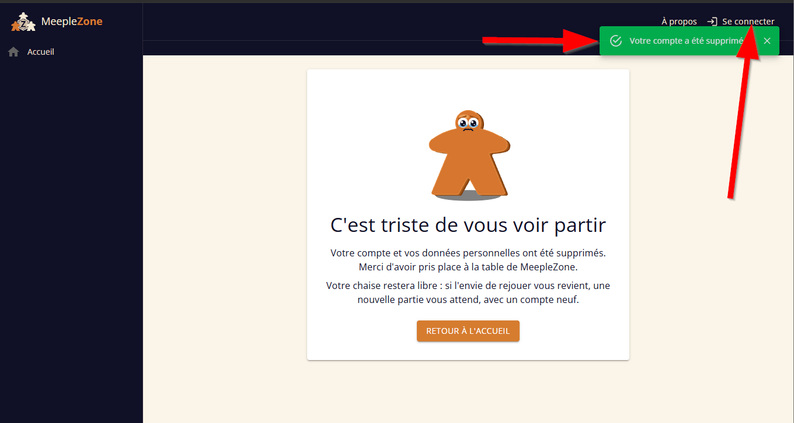
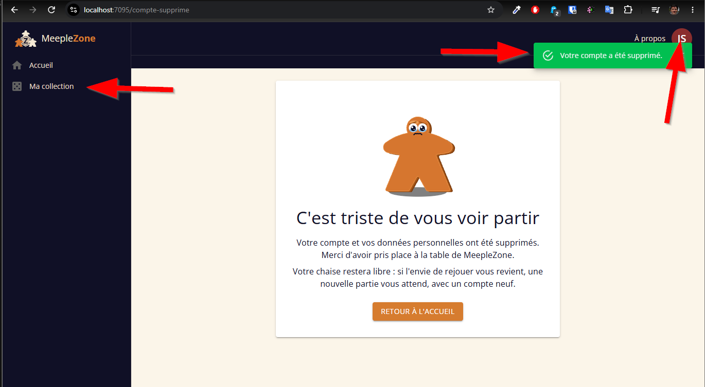

Un bogue peut être invisible dans le code et évident dans l'écran. Celui-ci en est un : tout le code était « correct », et pourtant le site affichait deux choses contradictoires en même temps. Cet article raconte comment le débogueur de Visual Studio a permis de le localiser en quelques minutes, une fois la bonne question posée, et comment le correctif a été écrit en commençant par un test qui échoue.

La session de débogage complète, menée en français avec un assistant qui guide pendant que la personne débogue, est publiée : [transcription de la session](https://gisthost.github.io/?d05c2d38df0d8727f8a020bb4f2b0a45/index.html) (voir aussi la section « La transcription », plus bas).

## Le symptôme

Le site propose la suppression de compte (ADR 0006). Une fois la suppression confirmée, la personne arrive sur une page d'adieu, `/compte-supprime`, avec un message de confirmation.

Jusque-là, tout va bien. Le bogue apparaît si la personne clique sur « Se connecter » depuis cette page et se connecte avec un autre compte : elle revient sur la page d'adieu.

La personne est connectée (l'avatar et « Ma collection » le montrent) et la page lui dit en même temps que son compte n'existe plus. L'impression est celle d'un compte neuf effacé par erreur. Rien ne plante, aucune erreur n'est journalisée : seul le comportement est faux.

## Une première hypothèse, à confirmer

Dès la lecture du code, une explication paraissait probable. Le menu de la barre du haut construit le lien de connexion avec l'adresse de la page courante comme adresse de retour : `/connexion-requise?retour=<page courante>`. Depuis la page d'adieu, le retour serait donc… la page d'adieu.

Une hypothèse, toutefois, n'est pas une preuve. Une autre piste est d'ailleurs apparue en route : si Google ne redemande pas quel compte utiliser, la reconnexion pourrait se faire avec le même compte, et l'effet serait trompeur. Cette piste est distincte et a été consignée à part (issue #161). Pour ce bogue-ci, il fallait voir la valeur de l'adresse de retour, pas la déduire.

## Le point d'arrêt

La validation de l'adresse de retour est centralisée dans une seule méthode, `UrlRetour.Valider`, qui refuse tout ce qui n'est pas un chemin local sûr. Un point d'arrêt sur sa dernière ligne, `return url;`, l'endroit atteint seulement quand l'adresse est jugée acceptable, répondait à la question : « l'adresse de la page d'adieu est-elle acceptée ? ». Des points d'arrêt sur les quatre `return Defaut;` plus haut servaient de contrôle : s'ils s'arrêtent, c'est que l'adresse a été refusée.

Après la suppression du compte, un clic sur « Se connecter » a arrêté le programme sur la dernière ligne.

La fenêtre d'espion le dit sans ambiguïté : `url` vaut `"/compte-supprime"` et la méthode s'apprête à le renvoyer tel quel. Aucun des quatre refus n'a été atteint. La liste des préfixes interdits, au-dessus, ne contient que `/connexion` et `/deconnexion` : la page d'adieu n'y figure pas.

## La pile d'appels : qui a posé la question ?

Reste à savoir d'où vient cet appel. La pile d'appels l'indique.

C'est bien le menu : `MenuUtilisateur.LienConnexion` passe la page courante à `Valider`, qui la valide… et la renvoie. L'hypothèse du départ est confirmée par les faits.

Le débogueur a aussi montré que le problème ne s'arrêtait pas là. En poursuivant l'exécution, l'arrêt suivant est survenu dans la page de connexion, avec la même valeur.

La page `/connexion-requise` reçoit `retour=/compte-supprime`, la revalide (même méthode, même réponse) et la reporte dans les liens « Continuer avec Google » et « Continuer avec Microsoft ». Après la connexion, le site redirige vers cette adresse. La boucle est complète :

1. le menu envoie la page courante, `/compte-supprime`, comme adresse de retour;
2. la page de connexion la revalide et l'accepte;
3. le fournisseur renvoie la personne connectée vers cette adresse;
4. la page d'adieu est publique et ne regarde pas la session : elle affiche son message comme si de rien n'était.

## Le test d'abord

Un bogue de ce genre revient facilement si rien ne le retient. Avant de toucher au code, le cas a été écrit dans les tests existants de `UrlRetour`, parmi les pages de connexion déjà refusées : quatre variantes de la page d'adieu (la casse change, une chaîne de requête est ajoutée, un `retour` imbriqué).

Les quatre échouent comme prévu : la méthode renvoyait l'adresse reçue au lieu de l'accueil. Un test rouge pour la bonne raison vaut mieux qu'un test vert dont on ne sait pas s'il peut échouer.

## Le correctif

Il tient en une ligne : ajouter `/compte-supprime` à la liste des préfixes interdits, au même endroit où se trouvent déjà `/connexion` et `/deconnexion`, avec le même commentaire (une page de fin de parcours ne doit pas devenir une destination de retour).

La méthode `Valider` est appelée à cinq endroits (le menu, la page de connexion, la redirection, les propriétés de connexion et le traitement de l'échec de connexion); un seul changement les couvre tous. Après le correctif, les 952 tests passent.

La vérification finale est faite dans le navigateur, avec le scénario qui avait produit le bogue.

Le lien du fournisseur pointe désormais vers `retour=%2F`, et la connexion mène à l'accueil.

## Ce qui n'est pas dans ce correctif

Deux améliorations ont volontairement été laissées de côté, pour garder un PR petit et facile à relire (`Closes #159`) :

- reconnaître automatiquement les pages qui ne devraient jamais servir d'adresse de retour, au lieu de les lister une à une (issue #162);
- rediriger la page d'adieu vers l'accueil quand une personne y arrive déjà connectée (issue #163).

## La transcription

La session de débogage, en français, est publiée en entier : [transcription de la session](https://gisthost.github.io/?d05c2d38df0d8727f8a020bb4f2b0a45/index.html) ([source](https://gist.github.com/jeison-souza/d05c2d38df0d8727f8a020bb4f2b0a45)). Le code a été écrit et le débogueur utilisé par la personne qui développe; l'assistant guidait, posait les questions et relisait les résultats. Certains éléments (chemins, noms de comptes, identifiants) y sont remplacés par des marqueurs entre crochets, les avis automatiques de l'outil sont retirés, et le contenu des notes de mémoire du projet ainsi qu'une capture montrant d'autres personnes ont été remplacés par une mention.

## Ce que j'en retiens

- **Poser la question au débogueur plutôt que la déduire.** L'hypothèse était juste, mais c'est la valeur dans l'espion, `"/compte-supprime"`, qui a clos la discussion. Elle a aussi permis d'éliminer l'autre piste sans débat.
- **Un point d'arrêt sur le chemin de sortie.** Placer des points d'arrêt sur chaque `return` donne la réponse à « quel chemin a été pris ? » en un seul passage.
- **La pile d'appels montre le code qu'on n'a pas encore regardé.** Le deuxième appelant, dans la page de connexion, n'était pas dans l'hypothèse de départ.
- **Le test rouge d'abord.** Il prouve que le cas est bien couvert et qu'il l'était mal avant.
