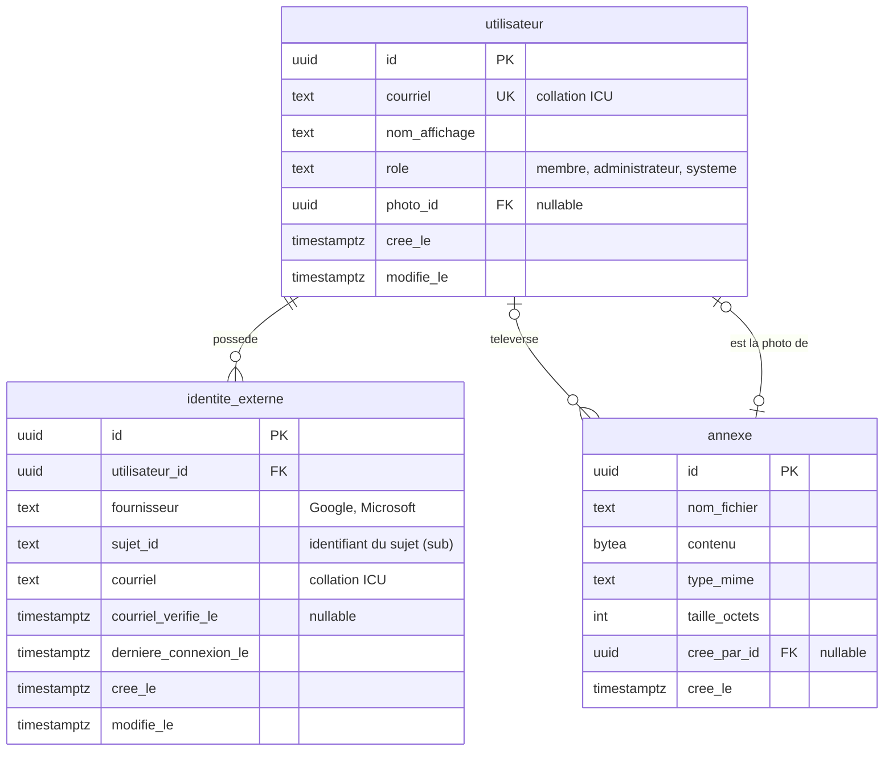

# Schéma de données de MeepleZone

| | |
|---|---|
| **Version** | 0.1 |
| **Date** | 13 octobre 2026 |
| **Statut** | Première version, révisée |
| **Portée** | Comptes (utilisateurs, connexions externes) et annexes (fichiers téléversés) |

Ce document décrit les tables de la base de données, leurs champs et leurs relations. Il s'écrit par étapes : la présente version couvre la base des comptes (utilisateurs, connexions externes) et les annexes (fichiers téléversés, dont la photo de profil). Les jeux, les collections et les amitiés s'ajoutent aux étapes suivantes.

Le système retenu est PostgreSQL (voir l'[ADR 0005](../adr/0005-base-de-donnees.md)). L'authentification passe uniquement par des fournisseurs externes, sans mot de passe local (voir l'[ADR 0001](../adr/0001-authentification.md)), et la liaison de plusieurs fournisseurs à un même compte suit l'[ADR 0004](../adr/0004-liaison-comptes-fournisseurs.md).

## Conventions

- Les noms de tables et de colonnes sont en français, en `snake_case` minuscule, sans accent mais en conservant la lettre (« Crée le » devient `cree_le`), au singulier et sans article. Dans le code C#, les propriétés restent en PascalCase (`CreeLe`) : la conversion est automatique.
- Les clés primaires s'appellent `id` et sont des `uuid`. Les clés étrangères se nomment `<table>_id`.
- Les dates et heures sont stockées en UTC (type `timestamptz`). Les colonnes d'horodatage se terminent par `_le`. La base de données les remplit elle-même : `cree_le` par une valeur par défaut (`DEFAULT now()`), et `modifie_le` par un déclencheur qui s'exécute à chaque modification. `modifie_le` n'existe que dans les tables dont les lignes changent.
- Les colonnes de texte comparées sans égard à la casse (le courriel) utilisent une collation non déterministe (ICU), car la comparaison de texte de PostgreSQL est sensible à la casse par défaut.

## Diagramme

## Lecture des tableaux de colonnes

Chaque table ci-dessous est décrite par un tableau à quatre colonnes : le nom de la colonne, son type PostgreSQL, ses contraintes et sa description. La colonne « Contraintes » utilise les termes de PostgreSQL :

| Terme | Sens |
|---|---|
| `PRIMARY KEY` | Identifie la ligne de façon unique (implique `NOT NULL` et `UNIQUE`). |
| `NOT NULL` | La valeur est obligatoire. Sans cette mention, la colonne peut être vide. |
| `UNIQUE` | Aucune valeur ne peut se répéter dans la table. |
| `REFERENCES table(colonne)` | Clé étrangère : la valeur doit exister dans l'autre table. |
| `ON DELETE SET NULL` | Si la ligne référencée est supprimée, la colonne devient vide. |
| `ON DELETE CASCADE` | Si la ligne référencée est supprimée, cette ligne l'est aussi. |
| `CHECK (...)` | Condition que la valeur doit respecter. |
| `DEFAULT ...` | Valeur utilisée quand aucune n'est fournie. |

## Table `utilisateur`

Représente une personne dans MeepleZone, indépendamment du fournisseur qu'elle utilise pour se connecter. Les collections, les amitiés et, plus tard, les soirées se rattachent à cette table, jamais à un fournisseur. Une personne qui se connecte tantôt avec Google, tantôt avec Microsoft reste donc le même utilisateur.

| Colonne | Type | Contraintes | Description |
|---|---|---|---|
| `id` | `uuid` | `PRIMARY KEY` | Identifiant de l'utilisateur. |
| `courriel` | `text` (collation ICU) | `NOT NULL`, `UNIQUE` | Courriel du compte. Copié de la première connexion externe, il est unique dans toute la table, sans égard à la casse (ADR 0004, règle 1). |
| `nom_affichage` | `text` | `NOT NULL` | Nom montré aux autres utilisateurs. Copié du fournisseur lors de la première connexion. |
| `role` | `text` | `NOT NULL`, `DEFAULT 'membre'`, `CHECK (role IN ('membre', 'administrateur', 'systeme'))` | Ce que la personne peut faire dans MeepleZone (voir ci-dessous). |
| `photo_id` | `uuid` | `REFERENCES annexe(id) ON DELETE SET NULL` | Photo de profil. Vide tant qu'aucune photo n'est enregistrée. |
| `cree_le` | `timestamptz` | `NOT NULL`, `DEFAULT now()` | Moment de création du compte (UTC). |
| `modifie_le` | `timestamptz` | `NOT NULL`, `DEFAULT now()` | Moment de la dernière modification (UTC), mis à jour par un déclencheur. |

Rôles :

- `membre` : l'utilisateur ordinaire, valeur par défaut.
- `administrateur` : peut aussi faire ce que fait un membre, plus les actions d'administration (par exemple modifier un jeu créé par quelqu'un d'autre).
- `systeme` : compte technique qui ne se connecte jamais, utilisé pour les actions automatiques. Il n'a aucune connexion externe (`identite_externe`) et son courriel est une adresse réservée qui ne reçoit rien; ces exceptions aux règles des connexions sont appliquées par le code.
- Un seul rôle par utilisateur. Si des rôles qui s'additionnent deviennent nécessaires (par exemple modérateur et administrateur), la colonne sera remplacée par une table de rôles.
- Le rôle ne se modifie jamais à partir d'une saisie de l'utilisateur.

À venir : les colonnes nécessaires à la suppression et à l'anonymisation d'un compte, à définir avec l'[ADR 0006](../adr/0006-suppression-de-compte.md).

## Table `identite_externe`

Chaque ligne est une façon de se connecter : un fournisseur et l'identifiant que ce fournisseur donne à la personne. Elle permet de rattacher plusieurs fournisseurs à un même utilisateur (ADR 0004, option B : liaison explicite).

| Colonne | Type | Contraintes | Description |
|---|---|---|---|
| `id` | `uuid` | `PRIMARY KEY` | Identifiant de la connexion. |
| `utilisateur_id` | `uuid` | `NOT NULL`, `REFERENCES utilisateur(id) ON DELETE CASCADE` | Utilisateur auquel appartient cette connexion. |
| `fournisseur` | `text` | `NOT NULL` | Nom du fournisseur (`Google`, `Microsoft`). Un texte plutôt qu'une table de référence : l'ajout d'un fournisseur (ADR 0001) ne demande pas de modification du schéma. |
| `sujet_id` | `text` | `NOT NULL` | Identifiant stable de la personne chez le fournisseur (`sub`). Contrairement au courriel, il ne change pas. |
| `courriel` | `text` (collation ICU) | `NOT NULL` | Courriel communiqué par ce fournisseur. Il peut changer chez le fournisseur : la règle de mise à jour reste à fixer. |
| `courriel_verifie_le` | `timestamptz` | | Moment où le courriel a été reconnu comme vérifié (UTC). Rempli à partir de l'information du fournisseur ou, au besoin, par une vérification propre à MeepleZone. |
| `derniere_connexion_le` | `timestamptz` | `NOT NULL`, `DEFAULT now()` | Dernière fois que la personne s'est connectée avec ce fournisseur (UTC). Écrite à la connexion, pas à chaque requête. |
| `cree_le` | `timestamptz` | `NOT NULL`, `DEFAULT now()` | Moment où la connexion a été associée au compte (UTC). |
| `modifie_le` | `timestamptz` | `NOT NULL`, `DEFAULT now()` | Moment de la dernière modification (UTC), mis à jour par un déclencheur. Une simple connexion (`derniere_connexion_le`) ne compte pas comme une modification. |

Contrainte sur la table : `UNIQUE (fournisseur, sujet_id)`.

Règles :

- Le couple (`fournisseur`, `sujet_id`) est unique : une même connexion externe ne peut appartenir qu'à un seul utilisateur (ADR 0004, règle 2).
- Un utilisateur possède une ou plusieurs connexions externes (relation un à plusieurs). La dernière connexion d'un compte ne peut pas être retirée; cette règle est appliquée par le code et non par la base.
- Le courriel n'est pas unique dans cette table : une même personne peut avoir le même courriel chez deux fournisseurs. L'unicité entre comptes différents est garantie par `utilisateur.courriel` et par le code.
- Le courriel de l'utilisateur correspond à celui d'une de ses connexions externes (règle appliquée par le code).
- Le dernier accès d'une personne, et le fournisseur utilisé, se lisent dans la connexion dont `derniere_connexion_le` est la plus récente. Aucune adresse IP ni information sur le navigateur n'est conservée.
- Les connexions n'appartiennent qu'à l'utilisateur et aucune autre table n'en dépend : la suppression en cascade (`ON DELETE CASCADE`) est sûre ici. Le comportement des autres clés étrangères vers `utilisateur` se décide cas par cas avec l'[ADR 0006](../adr/0006-suppression-de-compte.md) (par exemple, le créateur d'un jeu déjà dans la collection d'autres personnes ne peut pas entraîner la suppression du jeu).

## Table `annexe`

Conserve un fichier téléversé (pour l'instant des images) dans la base de données, plutôt qu'un simple lien. Les adresses d'images des fournisseurs peuvent expirer ou changer, et les jeux créés par les utilisateurs auront besoin d'une couverture : une table générique sert aux deux, et à d'autres usages futurs. Elle est distincte des tables qui l'utilisent, ce qui évite de charger l'image à chaque lecture d'un utilisateur ou d'un jeu.

| Colonne | Type | Contraintes | Description |
|---|---|---|---|
| `id` | `uuid` | `PRIMARY KEY` | Identifiant de l'annexe. |
| `nom_fichier` | `text` | `NOT NULL`, `CHECK (char_length(nom_fichier) BETWEEN 1 AND 255)` | Nom du fichier tel qu'il sera affiché ou proposé au téléchargement. Pour une photo de profil récupérée chez un fournisseur, un nom généré (par exemple `photo-profil.webp`). |
| `contenu` | `bytea` | `NOT NULL` | Le fichier, ici une image redimensionnée et réencodée. |
| `type_mime` | `text` | `NOT NULL` | Format du fichier (`image/webp`, `image/jpeg`). |
| `taille_octets` | `integer` | `NOT NULL`, `CHECK (taille_octets > 0)` | Taille du contenu, pour la limiter et la vérifier. |
| `cree_par_id` | `uuid` | `REFERENCES utilisateur(id) ON DELETE SET NULL` | Utilisateur qui a téléversé le fichier (créé par). Passe à vide si ce compte est supprimé. |
| `cree_le` | `timestamptz` | `NOT NULL`, `DEFAULT now()` | Moment du téléversement (UTC). Pas de `modifie_le` : une annexe ne change pas. |

Règles :

- Les références vont de la table qui utilise l'annexe vers l'annexe : `utilisateur.photo_id` et, plus tard, `jeu.couverture_id`. L'annexe ne connaît pas son utilisateur, ce qui évite une association polymorphe sans clé étrangère.
- Une annexe est immuable : pour changer une photo, une nouvelle annexe est créée, la référence est mise à jour et l'ancienne est supprimée. L'identifiant suffit alors à mettre l'image en cache.
- « Qui l'a créée » (`cree_par_id`) est distinct de « qui l'utilise » : la couverture d'un jeu reste en place si la personne qui l'a téléversée supprime son compte.
- Le nom du fichier est une donnée fournie par l'utilisateur : il est nettoyé avant d'être enregistré (sans chemin ni caractères de contrôle) et ne sert jamais à construire un chemin sur un disque. Comme l'image est réencodée, son extension correspond au `type_mime` conservé.
- La photo de profil est téléchargée une seule fois, à la première connexion, depuis l'adresse fournie par le fournisseur, avec une limite de taille. Elle est ensuite redimensionnée et réencodée avant d'être conservée.
- La photo est facultative : sans photo, l'interface affiche un avatar avec les initiales.
- La photo est un renseignement personnel : elle est supprimée avec le compte (ADR 0006).

## Reste à décider

- Mise à jour du courriel d'une connexion externe lorsqu'il change chez le fournisseur, et traitement des conflits avec un autre compte.
- Vérification du courriel lorsque le fournisseur ne la confirme pas.
- Colonnes de suppression et d'anonymisation d'un compte (ADR 0006), et comportement à la suppression (`ON DELETE`) de chaque clé étrangère vers `utilisateur`. Si le compte est anonymisé plutôt que supprimé, ces règles servent de filet de sécurité.
- Création du premier administrateur et du compte système (données initiales).

## À surveiller

- Volume des annexes : si la base grossit trop, le `contenu` pourra être déplacé vers le disque ou un stockage d'objets sans modifier les références (`photo_id`, `couverture_id`). Le changement n'est pas préparé pour l'instant.

## Étapes suivantes

Jeux (catalogue partagé, avec couverture), collection d'un utilisateur, amitiés et visibilité de la collection.

## Historique des versions

| Version | Date | Changement |
|---|---|---|
| 0.1 | 13 octobre 2026 | Première version : `utilisateur`, `identite_externe` et `annexe`. |

Le numéro de version monte à chaque ajout ou modification importante du schéma (0.2 pour la prochaine étape, par exemple). La version 1.0 correspondra au schéma complet du produit minimal viable.
