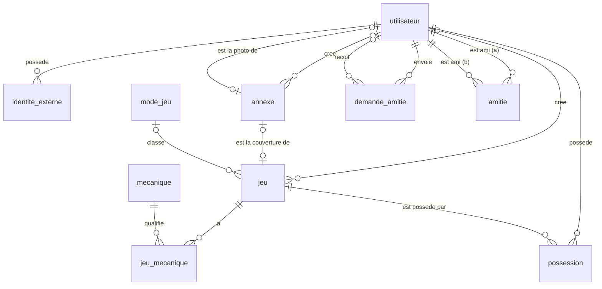
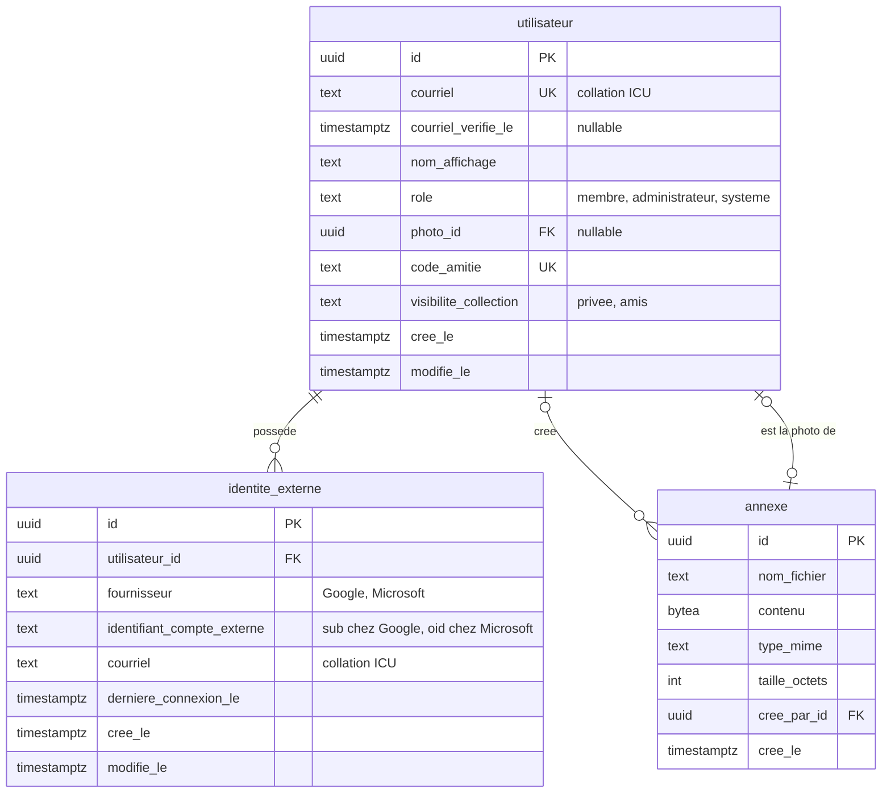
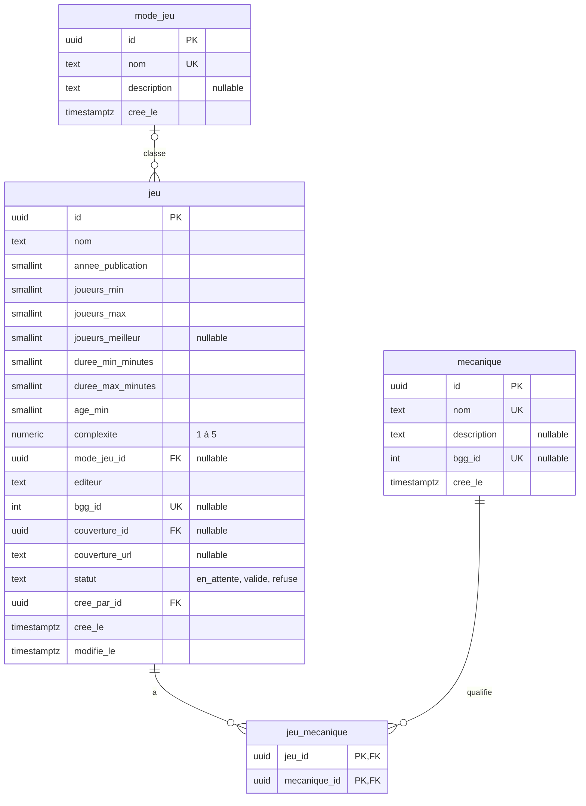
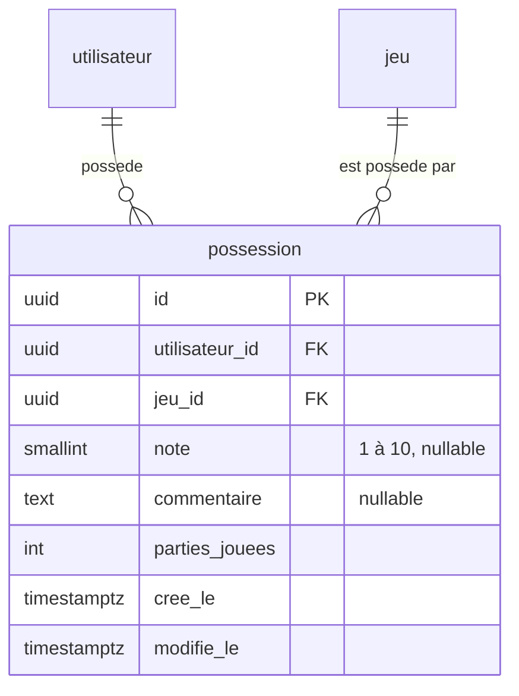
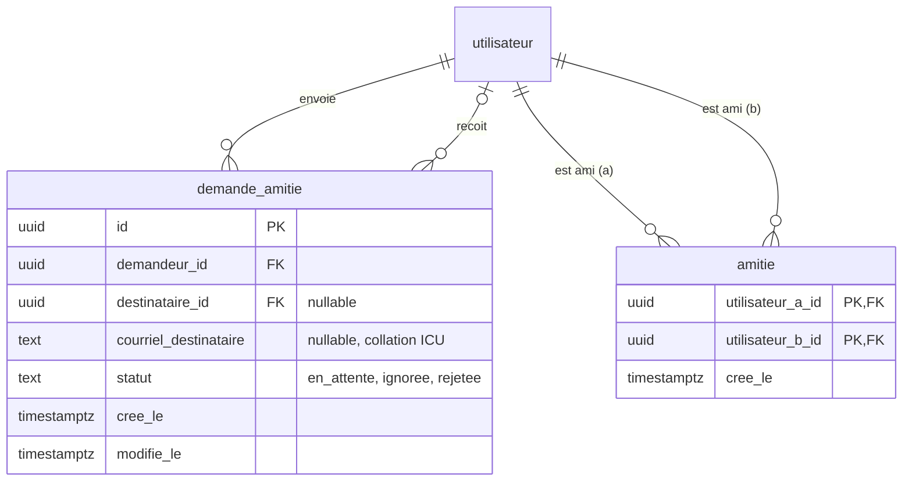

# Schéma de données de MeepleZone

| | |
|---|---|
| **Version** | 0.4 |
| **Date** | 17 octobre 2026 |
| **Statut** | Toutes les tables du produit minimal viable, en un seul document; à relire |
| **Portée** | Comptes, annexes, catalogue de jeux, collection et amitiés |

Ce document décrit les tables de la base de données, leurs champs et leurs relations. Il réunit en un seul schéma les quatre blocs du produit minimal viable : les comptes et les annexes, le catalogue de jeux, la collection de chaque utilisateur et les amitiés.

Le système retenu est PostgreSQL (voir l'[ADR 0005](../adr/0005-base-de-donnees.md)). L'authentification passe uniquement par des fournisseurs externes, sans mot de passe local (voir l'[ADR 0001](../adr/0001-authentification.md)), et la liaison de plusieurs fournisseurs à un même compte suit l'[ADR 0004](../adr/0004-liaison-comptes-fournisseurs.md).

## Contenu

1. [Conventions](#conventions) et [lecture des tableaux de colonnes](#lecture-des-tableaux-de-colonnes)
2. [Vue d'ensemble](#vue-densemble)
3. [Comptes et annexes](#comptes-et-annexes) : `utilisateur`, `identite_externe`, `annexe`
4. [Catalogue de jeux](#catalogue-de-jeux) : `jeu`, `mode_jeu`, `mecanique`, `jeu_mecanique`
5. [Collection](#collection) : `possession`
6. [Amitiés](#amitiés) : `demande_amitie`, `amitie`
7. [Reste à décider](#reste-à-décider)

## Conventions

- Les noms de tables et de colonnes sont en français, en `snake_case` minuscule, sans accent mais en conservant la lettre (« Crée le » devient `cree_le`), au singulier et sans article. Dans le code C#, les propriétés restent en PascalCase (`CreeLe`) : la conversion est automatique.
- Les clés primaires s'appellent `id` et sont des `uuid`. Les clés étrangères se nomment `<table>_id` (par exemple `utilisateur_id`). Quand il faut préciser la fonction de la ligne référencée dans la relation, ce nom de fonction remplace le nom de la table : `cree_par_id` (l'utilisateur qui a créé) et `demandeur_id` (l'utilisateur qui fait la demande).
- Les dates et heures sont stockées en UTC (type `timestamptz`). Les colonnes d'horodatage se terminent par `_le`. `cree_le` est rempli par la base de données (valeur par défaut `DEFAULT now()`); `modifie_le` reçoit la même valeur par défaut à l'insertion, puis l'application le met à jour à chaque modification (aucun déclencheur dans la base). `modifie_le` n'existe que dans les tables dont les lignes changent.
- Les colonnes de texte comparées sans égard à la casse (le courriel) utilisent une collation non déterministe (ICU), car la comparaison de texte de PostgreSQL est sensible à la casse par défaut.
- Les valeurs qui forment une courte liste fixe (rôle, statut) sont des textes limités par une contrainte `CHECK`.

### Lecture des tableaux de colonnes

Chaque table est décrite par un tableau à quatre colonnes : le nom de la colonne, son type PostgreSQL, ses contraintes et sa description. La colonne « Contraintes » utilise les termes de PostgreSQL :

| Terme | Sens |
|---|---|
| `PRIMARY KEY` | Identifie la ligne de façon unique (implique `NOT NULL` et `UNIQUE`). |
| `NOT NULL` | La valeur est obligatoire. Sans cette mention, la colonne peut être vide. |
| `UNIQUE` | Aucune valeur ne peut se répéter dans la table. |
| `REFERENCES table(colonne)` | Clé étrangère : la valeur doit exister dans l'autre table. |
| `ON DELETE SET NULL` | Si la ligne référencée est supprimée, la colonne devient vide. |
| `ON DELETE CASCADE` | Si la ligne référencée est supprimée, cette ligne l'est aussi. |
| `ON DELETE RESTRICT` | La ligne référencée ne peut pas être supprimée tant qu'elle est utilisée. |
| `CHECK (...)` | Condition que la valeur doit respecter. |
| `DEFAULT ...` | Valeur utilisée quand aucune n'est fournie. |
| `¹` | Contrainte aussi vérifiée dans le code (voir ci-dessous). |

¹ Une contrainte marquée de ce signe est aussi vérifiée dans le code du domaine, et un test automatique en confirme la règle. La base de données reste la dernière protection (une erreur de code, une modification manuelle), mais la règle est d'abord exprimée dans le code, où elle se lit et se teste sans base réelle. Les contraintes non marquées (clés étrangères, unicité) ne sont garanties que par la base; le code n'en gère que l'erreur.

## Vue d'ensemble

Le diagramme ne montre que les relations. Les colonnes de chaque table figurent dans le diagramme de sa section.

## Comptes et annexes

### Table `utilisateur`

Représente une personne dans MeepleZone, indépendamment du fournisseur qu'elle utilise pour se connecter. Les collections et les amitiés se rattachent à cette table, jamais à un fournisseur. Une personne qui se connecte tantôt avec Google, tantôt avec Microsoft reste donc le même utilisateur.

| Colonne | Type | Contraintes | Description |
|---|---|---|---|
| `id` | `uuid` | `PRIMARY KEY` | Identifiant de l'utilisateur. |
| `courriel` | `text` (collation ICU) | `NOT NULL`, `UNIQUE` | Courriel du compte : celui que MeepleZone utilise pour joindre la personne et pour la retrouver (recherche d'amis). Copié de la première connexion externe, il appartient ensuite à la personne, qui pourra le changer. Il est unique dans toute la table, sans égard à la casse (ADR 0004, règle 1). |
| `courriel_verifie_le` | `timestamptz` | | Moment où le courriel du compte a été reconnu comme vérifié (UTC) : dès la première connexion si le fournisseur l'atteste, sinon par un code envoyé par MeepleZone. Vide tant qu'il ne l'est pas, et effacé quand le courriel change. La connexion ne dépend pas de cette valeur : elle autorise les communications par courriel et la recherche d'amis par courriel. |
| `nom_affichage` | `text` | `NOT NULL` | Nom montré aux autres utilisateurs. Copié du fournisseur lors de la première connexion. |
| `role` | `text` | `NOT NULL`, `DEFAULT 'membre'`, `CHECK (role IN ('membre', 'administrateur', 'systeme'))`¹ | Ce que la personne peut faire dans MeepleZone (voir ci-dessous). |
| `photo_id` | `uuid` | `REFERENCES annexe(id) ON DELETE SET NULL` | Photo de profil. Vide tant qu'aucune photo n'est enregistrée. |
| `code_amitie` | `text` | `NOT NULL`, `UNIQUE`, `CHECK (code_amitie ~ '^[A-HJ-NP-Z2-9]{8}$')`¹ | Code que la personne peut donner pour qu'on lui demande son amitié (voir la section sur les amitiés). |
| `visibilite_collection` | `text` | `NOT NULL`, `DEFAULT 'privee'`, `CHECK (visibilite_collection IN ('privee', 'amis'))`¹ | Qui peut voir la collection : `privee` (la personne seule) ou `amis` (la personne et ses amis acceptés). Une nouvelle personne commence à `privee`. |
| `cree_le` | `timestamptz` | `NOT NULL`, `DEFAULT now()` | Moment de création du compte (UTC). |
| `modifie_le` | `timestamptz` | `NOT NULL`, `DEFAULT now()` | Moment de la dernière modification (UTC), mis à jour par l'application. |

Rôles :

- `membre` : l'utilisateur ordinaire, valeur par défaut.
- `administrateur` : peut aussi faire ce que fait un membre, plus les actions d'administration (par exemple valider un jeu créé par quelqu'un d'autre).
- `systeme` : compte technique qui ne se connecte jamais, utilisé pour les actions automatiques. Il n'a aucune connexion externe (`identite_externe`) et son courriel est une adresse réservée qui ne reçoit rien; ces exceptions aux règles des connexions sont appliquées par le code. Il est créé par les données initiales.
- Un seul rôle par utilisateur. Si des rôles qui s'additionnent deviennent nécessaires (par exemple modérateur et administrateur), la colonne sera remplacée par une table de rôles.
- Le rôle ne se modifie jamais à partir d'une saisie de l'utilisateur. Le premier administrateur est promu par une mise à jour manuelle dans la base de données, après sa première connexion.

Quand une personne supprime son compte, sa ligne est supprimée et ses données personnelles disparaissent avec elle. Le contenu partagé qu'elle a créé (jeux, couvertures) est conservé et rattaché au compte technique « Utilisateur supprimé » (voir l'[ADR 0006](../adr/0006-suppression-de-compte.md)).

### Table `identite_externe`

Chaque ligne est une façon de se connecter : un fournisseur et l'identifiant que ce fournisseur donne à la personne. Elle permet de rattacher plusieurs fournisseurs à un même utilisateur (ADR 0004, option B : liaison explicite).

| Colonne | Type | Contraintes | Description |
|---|---|---|---|
| `id` | `uuid` | `PRIMARY KEY` | Identifiant de la connexion. |
| `utilisateur_id` | `uuid` | `NOT NULL`, `REFERENCES utilisateur(id) ON DELETE CASCADE` | Utilisateur auquel appartient cette connexion. |
| `fournisseur` | `text` | `NOT NULL` | Nom du fournisseur (`Google`, `Microsoft`). Un texte plutôt qu'une table de référence : l'ajout d'un fournisseur (ADR 0001) ne demande pas de modification du schéma. |
| `identifiant_compte_externe` | `text` | `NOT NULL` | Identifiant stable du compte de la personne chez le fournisseur : le `sub` chez Google, l'`oid` chez Microsoft. Contrairement au courriel, il ne change pas. |
| `courriel` | `text` (collation ICU) | `NOT NULL` | Courriel communiqué par ce fournisseur, conservé à titre d'information (il aide le soutien à retrouver un compte). Il se met à jour quand il change chez le fournisseur, sans effet sur le courriel du compte. |
| `derniere_connexion_le` | `timestamptz` | `NOT NULL`, `DEFAULT now()` | Dernière fois que la personne s'est connectée avec ce fournisseur (UTC). Écrite à la connexion, pas à chaque requête. |
| `cree_le` | `timestamptz` | `NOT NULL`, `DEFAULT now()` | Moment où la connexion a été associée au compte (UTC). |
| `modifie_le` | `timestamptz` | `NOT NULL`, `DEFAULT now()` | Moment de la dernière modification (UTC), mis à jour par l'application. Une simple connexion (`derniere_connexion_le`) ne compte pas comme une modification. |

Contrainte sur la table : `UNIQUE (fournisseur, identifiant_compte_externe)`.

Règles :

- Le couple (`fournisseur`, `identifiant_compte_externe`) est unique : une même connexion externe ne peut appartenir qu'à un seul utilisateur (ADR 0004, règle 2).
- Un utilisateur possède une ou plusieurs connexions externes (relation un à plusieurs). La dernière connexion d'un compte ne peut pas être retirée; cette règle est appliquée par le code et non par la base.
- Le courriel n'est pas unique dans cette table : une même personne peut avoir le même courriel chez deux fournisseurs. L'unicité entre comptes différents est garantie par `utilisateur.courriel` et par le code.
- À la création du compte, `utilisateur.courriel` est celui de la première connexion. Ensuite il peut différer de ceux des connexions, car la personne peut changer le sien et les fournisseurs peuvent changer le leur.
- Le dernier accès d'une personne, et le fournisseur utilisé, se lisent dans la connexion dont `derniere_connexion_le` est la plus récente. Aucune adresse IP ni information sur le navigateur n'est conservée.
- Les connexions n'appartiennent qu'à l'utilisateur et aucune autre table n'en dépend : la suppression en cascade (`ON DELETE CASCADE`) est sûre ici. Le comportement des autres clés étrangères vers `utilisateur` est fixé par l'[ADR 0006](../adr/0006-suppression-de-compte.md) : `CASCADE` pour les données personnelles, `RESTRICT` pour `cree_par_id`.

### Table `annexe`

Conserve un fichier téléversé (pour l'instant des images) dans la base de données, plutôt qu'un simple lien. Les adresses d'images des fournisseurs peuvent expirer ou changer, et les jeux créés par les utilisateurs ont besoin d'une couverture : une table générique sert aux deux, et à d'autres usages futurs. Elle est distincte des tables qui l'utilisent, ce qui évite de charger l'image à chaque lecture d'un utilisateur ou d'un jeu.

| Colonne | Type | Contraintes | Description |
|---|---|---|---|
| `id` | `uuid` | `PRIMARY KEY` | Identifiant de l'annexe. |
| `nom_fichier` | `text` | `NOT NULL`, `CHECK (char_length(nom_fichier) BETWEEN 1 AND 255)`¹ | Nom du fichier tel qu'il sera affiché ou proposé au téléchargement. Pour une photo de profil récupérée chez un fournisseur, un nom généré (par exemple `photo-profil.webp`). |
| `contenu` | `bytea` | `NOT NULL` | Le fichier, ici une image redimensionnée et réencodée. |
| `type_mime` | `text` | `NOT NULL` | Format du fichier (`image/webp`, `image/jpeg`). |
| `taille_octets` | `integer` | `NOT NULL`, `CHECK (taille_octets > 0)`¹ | Taille du contenu, pour la limiter et la vérifier. |
| `cree_par_id` | `uuid` | `NOT NULL`, `REFERENCES utilisateur(id) ON DELETE RESTRICT` | Utilisateur qui a téléversé le fichier (créé par). À la suppression de son compte, le code le remplace par le compte technique « Utilisateur supprimé »; la photo de profil, elle, est supprimée avec le compte. |
| `cree_le` | `timestamptz` | `NOT NULL`, `DEFAULT now()` | Moment du téléversement (UTC). Pas de `modifie_le` : une annexe ne change pas. |

Règles :

- Les références vont de la table qui utilise l'annexe vers l'annexe : `utilisateur.photo_id` et `jeu.couverture_id`. L'annexe ne connaît pas son utilisateur, ce qui évite une association polymorphe sans clé étrangère.
- Une annexe est immuable : pour changer une photo, une nouvelle annexe est créée, la référence est mise à jour et l'ancienne est supprimée. L'identifiant suffit alors à mettre l'image en cache.
- « Qui l'a créée » (`cree_par_id`) est distinct de « qui l'utilise » : la couverture d'un jeu reste en place si la personne qui l'a téléversée supprime son compte.
- Le nom du fichier est une donnée fournie par l'utilisateur : il est nettoyé avant d'être enregistré (sans chemin ni caractères de contrôle) et ne sert jamais à construire un chemin sur un disque. Comme l'image est réencodée, son extension correspond au `type_mime` conservé.
- La photo de profil est téléchargée une seule fois, à la première connexion, depuis l'adresse fournie par le fournisseur, avec une limite de taille. Elle est ensuite redimensionnée et réencodée avant d'être conservée.
- La photo est facultative : sans photo, l'interface affiche un avatar avec les initiales.
- La photo est un renseignement personnel : elle est supprimée avec le compte (ADR 0006).

## Catalogue de jeux

Le catalogue est partagé par tous les utilisateurs et ne contient que des **faits** sur les jeux. Ce qui est personnel (la possession d'un jeu, une note, un commentaire) appartient à la collection de chaque personne, décrite dans la section suivante.

### Table `jeu`

Un jeu de société du catalogue. Chaque jeu y existe **une seule fois** : plusieurs utilisateurs peuvent le posséder sans que ses caractéristiques soient copiées. Un jeu provient soit de BoardGameGeek, soit d'un utilisateur qui l'a créé à la main quand il est absent des deux.

| Colonne | Type | Contraintes | Description |
|---|---|---|---|
| `id` | `uuid` | `PRIMARY KEY` | Identifiant du jeu. |
| `nom` | `text` | `NOT NULL`, `CHECK (char_length(nom) BETWEEN 1 AND 255)`¹ | Nom du jeu. C'est le seul champ que la personne doit remplir : un jeu créé à la main peut être décrit en peu de mots. Les autres colonnes obligatoires (`statut`, `cree_par_id`, dates) sont remplies par l'application ou par la base de données. Plusieurs jeux peuvent porter le même nom. |
| `annee_publication` | `smallint` | | Année de publication. |
| `joueurs_min` | `smallint` | `CHECK (joueurs_min >= 1)`¹ | Nombre minimal de joueurs. |
| `joueurs_max` | `smallint` | `CHECK (joueurs_max >= 1)`¹ | Nombre maximal de joueurs. |
| `joueurs_meilleur` | `smallint` | `CHECK (joueurs_meilleur >= 1)`¹ | Nombre de joueurs avec lequel le jeu est le plus apprécié (le « meilleur » nombre de joueurs). Une seule valeur, comprise entre le minimum et le maximum quand ils sont connus. |
| `duree_min_minutes` | `smallint` | `CHECK (duree_min_minutes > 0)`¹ | Durée minimale d'une partie, en minutes. |
| `duree_max_minutes` | `smallint` | `CHECK (duree_max_minutes > 0)`¹ | Durée maximale d'une partie, en minutes. |
| `age_min` | `smallint` | `CHECK (age_min >= 0)`¹ | Âge minimal recommandé. |
| `complexite` | `numeric(2,1)` | `CHECK (complexite BETWEEN 1 AND 5)`¹ | Complexité de 1 à 5, sur la même échelle que BoardGameGeek (le « poids »). Pour un jeu créé à la main, c'est le choix de la personne. |
| `mode_jeu_id` | `uuid` | `REFERENCES mode_jeu(id) ON DELETE RESTRICT` | Mode de jeu : qui joue contre qui (compétitif, coopératif, etc.). Peut être vide si le mode est inconnu. |
| `editeur` | `text` | | Éditeur, en texte simple. Avec l'année, il aide à distinguer des jeux qui portent le même nom. |
| `bgg_id` | `integer` | `UNIQUE` | Identifiant du jeu chez BoardGameGeek. Présent seulement pour un jeu importé. |
| `couverture_id` | `uuid` | `REFERENCES annexe(id) ON DELETE SET NULL` | Image de couverture téléversée par un utilisateur. |
| `couverture_url` | `text` | | Adresse de l'image de couverture chez BoardGameGeek. Seule l'adresse est conservée, jamais l'image. |
| `statut` | `text` | `NOT NULL`, `DEFAULT 'en_attente'`, `CHECK (statut IN ('en_attente', 'valide', 'refuse'))`¹ | État de validation du jeu (voir ci-dessous). |
| `cree_par_id` | `uuid` | `NOT NULL`, `REFERENCES utilisateur(id) ON DELETE RESTRICT` | Utilisateur qui a créé ou importé le jeu. À la suppression de son compte, le code le remplace par le compte technique « Utilisateur supprimé » (voir l'[ADR 0006](../adr/0006-suppression-de-compte.md)). |
| `cree_le` | `timestamptz` | `NOT NULL`, `DEFAULT now()` | Moment de la création (UTC). |
| `modifie_le` | `timestamptz` | `NOT NULL`, `DEFAULT now()` | Moment de la dernière modification (UTC), mis à jour par l'application. |

Contraintes sur la table :

- `CHECK (joueurs_min IS NULL OR joueurs_max IS NULL OR joueurs_min <= joueurs_max)`¹
- `CHECK (joueurs_meilleur IS NULL OR joueurs_min IS NULL OR joueurs_meilleur >= joueurs_min)`¹
- `CHECK (joueurs_meilleur IS NULL OR joueurs_max IS NULL OR joueurs_meilleur <= joueurs_max)`¹
- `CHECK (duree_min_minutes IS NULL OR duree_max_minutes IS NULL OR duree_min_minutes <= duree_max_minutes)`¹
- `CHECK (couverture_id IS NULL OR couverture_url IS NULL)`¹ : une couverture est un fichier téléversé ou une adresse externe, jamais les deux.

Règles :

- Le catalogue ne contient que des faits sur le jeu. Les informations personnelles (note, commentaire, possession) vont dans la collection de chaque utilisateur.
- **Origine du jeu :** un `bgg_id` présent signifie que le jeu vient de BoardGameGeek; sinon, il a été créé par un utilisateur. Aucune colonne `source` n'est ajoutée pour l'instant.
- **Données de BoardGameGeek :** seuls quelques détails de base sont conservés, sans modification, et seulement pour les jeux qu'un utilisateur ajoute (jamais la base complète), avec mention de BoardGameGeek comme source, conformément aux conditions d'utilisation de son API.
- **Jeux importés en lecture seule :** les détails importés de BoardGameGeek ne sont modifiés par personne, utilisateurs et administrateur compris, car les conditions d'utilisation de son API interdisent de modifier les données. Ils ne peuvent être que remplacés par une nouvelle importation. Les colonnes propres à MeepleZone (`statut`, `modifie_le`, etc.) se gèrent normalement. Une règle du code, et non de la base de données.
- **Validation :** un jeu créé à la main commence à `en_attente`. Il n'est alors visible que pour la personne qui l'a créé, qui peut l'ajouter à sa collection. L'administrateur le passe à `valide` (visible pour tous) ou à `refuse`. Les jeux importés de BoardGameGeek sont `valide`.
- Au début, l'administrateur valide par une mise à jour manuelle dans la base de données; une page d'administration est l'objectif à terme.
- **Modification d'un jeu validé :** elle le ramène à `en_attente` (règle appliquée par le code). C'est surtout la couverture qui justifie ce contrôle.
- **Distinguer des jeux de même nom :** le nom n'est pas unique. L'identifiant d'un jeu importé est son `bgg_id`. Avant de créer un jeu, la recherche affiche le nom, l'année et l'éditeur pour que la personne reconnaisse un jeu déjà présent.

### Table `mode_jeu`

Le mode de jeu répond à la première question qu'on se pose sur un jeu : qui joue contre qui. Un jeu a **au plus un mode** (relation un à plusieurs : un mode classe plusieurs jeux). Les modes sont dans une table, et non dans une liste fixe du code, pour qu'ajouter un mode soit une simple ligne de données, et pour que chacun ait une description (par exemple une infobulle à l'écran).

| Colonne | Type | Contraintes | Description |
|---|---|---|---|
| `id` | `uuid` | `PRIMARY KEY` | Identifiant du mode. |
| `nom` | `text` | `NOT NULL`, `UNIQUE` | Nom du mode, tel qu'affiché (par exemple « Coopératif »). |
| `description` | `text` | | Explication du mode, pour l'infobulle, sur une ou plusieurs lignes. |
| `cree_le` | `timestamptz` | `NOT NULL`, `DEFAULT now()` | Moment de la création (UTC). |

Règles :

- Les modes initiaux sont chargés par les données initiales : compétitif, coopératif, semi-coopératif et par équipes. Seul l'administrateur modifie la liste.
- Un jeu jouable seul se reconnaît à `joueurs_min = 1`; aucune colonne ne s'y ajoute.
- À l'importation d'un jeu de BoardGameGeek, ses mécaniques « Cooperative Game », « Semi-Cooperative Game » et « Team-Based Game » donnent le mode correspondant; sans aucune des trois, le jeu est compétitif. Cette correspondance est faite par le code.
- Un mode encore utilisé ne peut pas être supprimé (`ON DELETE RESTRICT`).

### Table `mecanique`

Une mécanique de jeu (par exemple « gestion de main » ou « pose d'ouvriers »). La liste est **courte et choisie par MeepleZone** (une vingtaine de mécaniques, en français), chargée par les données initiales, plutôt que la liste complète de BoardGameGeek qui en compte près de deux cents.

| Colonne | Type | Contraintes | Description |
|---|---|---|---|
| `id` | `uuid` | `PRIMARY KEY` | Identifiant de la mécanique. |
| `nom` | `text` | `NOT NULL`, `UNIQUE` | Nom de la mécanique, en français. |
| `description` | `text` | | Explication de la mécanique, sur une ou plusieurs lignes. Le type `text` de PostgreSQL n'a pas de limite de longueur et conserve les sauts de ligne. |
| `bgg_id` | `integer` | `UNIQUE` | Identifiant de la mécanique correspondante chez BoardGameGeek, quand il en existe une. Sert à relier les jeux importés. |
| `cree_le` | `timestamptz` | `NOT NULL`, `DEFAULT now()` | Moment de la création (UTC). |

Règles :

- Seul l'administrateur modifie la liste. Une personne qui crée un jeu choisit parmi les mécaniques existantes.
- À l'importation d'un jeu de BoardGameGeek, une mécanique de BoardGameGeek sans correspondance (`bgg_id`) dans la liste est ignorée.
- La liste initiale des mécaniques et des modes est proposée dans un document à part, [mecaniques-initiales.md](mecaniques-initiales.md).

### Table `jeu_mecanique`

Table de liaison pure entre un jeu et ses mécaniques (relation plusieurs à plusieurs).

| Colonne | Type | Contraintes | Description |
|---|---|---|---|
| `jeu_id` | `uuid` | `NOT NULL`, `REFERENCES jeu(id) ON DELETE CASCADE` | Le jeu. |
| `mecanique_id` | `uuid` | `NOT NULL`, `REFERENCES mecanique(id) ON DELETE RESTRICT` | La mécanique. |

Contrainte sur la table : `PRIMARY KEY (jeu_id, mecanique_id)`.

Règles :

- La suppression d'un jeu supprime ses liens. Une mécanique encore utilisée ne peut pas être supprimée.

## Collection

La collection d'une personne est l'ensemble de ses lignes dans `possession` : le jeu qu'elle possède, la note qu'elle lui donne, son commentaire et le nombre de parties jouées. Il n'existe pas de table « collection ».

La visibilité de la collection est une préférence de la personne : elle est dans `utilisateur.visibilite_collection` et vaut pour la collection entière.

### Table `possession`

Un jeu du catalogue dans la collection d'une personne. Chaque ligne relie un utilisateur à un jeu et porte les données propres à cette personne.

| Colonne | Type | Contraintes | Description |
|---|---|---|---|
| `id` | `uuid` | `PRIMARY KEY` | Identifiant de la possession. |
| `utilisateur_id` | `uuid` | `NOT NULL`, `REFERENCES utilisateur(id) ON DELETE CASCADE` | La personne qui possède le jeu. Ses données de collection disparaissent avec son compte. |
| `jeu_id` | `uuid` | `NOT NULL`, `REFERENCES jeu(id) ON DELETE RESTRICT` | Le jeu possédé. Un jeu qui figure dans une collection ne peut pas être supprimé par mégarde. |
| `note` | `smallint` | `CHECK (note BETWEEN 1 AND 10)`¹ | Note personnelle de 1 à 10, comme sur BoardGameGeek. Vide quand la personne n'a pas noté le jeu. |
| `commentaire` | `text` | | Commentaire personnel, sur une ou plusieurs lignes. |
| `parties_jouees` | `integer` | `NOT NULL`, `DEFAULT 0`, `CHECK (parties_jouees >= 0)`¹ | Nombre de parties jouées, tenu comme un simple compteur. |
| `cree_le` | `timestamptz` | `NOT NULL`, `DEFAULT now()` | Moment où le jeu est entré dans la collection (UTC). |
| `modifie_le` | `timestamptz` | `NOT NULL`, `DEFAULT now()` | Moment de la dernière modification (UTC), mis à jour par l'application. |

Contrainte sur la table : `UNIQUE (utilisateur_id, jeu_id)`. Une personne possède un jeu une seule fois; les exemplaires multiples ne sont pas gérés.

Règles :

- **Ajouter un jeu à sa collection** crée une ligne. Une personne peut y ajouter un jeu qu'elle a créé et qui est encore `en_attente`.
- **Retirer un jeu** supprime la ligne, donc la note, le commentaire et le nombre de parties de cette personne pour ce jeu. L'interface demande une confirmation. La suppression est définitive : il n'y a pas de désactivation (« suppression logique »), ce qui est plus simple à gérer et ne laisse aucune donnée personnelle derrière.
- **Visibilité :** les amis acceptés voient la collection quand `utilisateur.visibilite_collection` vaut `amis`, avec les notes, les commentaires et le nombre de parties. La collection montrée aux autres **n'inclut que les jeux `valide`** : un jeu encore en attente de validation reste visible seulement pour la personne qui l'a créé.
- **Compteur de parties :** un simple nombre. Si le produit demande un jour de consigner chaque partie (date, personnes présentes), une table `partie` s'ajoutera.
- Pas d'état de possession (liste de souhaits, vendu, prêté) dans cette version.

## Amitiés

Deux tables se partagent le travail :

- **`demande_amitie`** est le parcours d'une demande, de son envoi jusqu'à la réponse. Elle sait **qui a demandé** et **à qui**.
- **`amitie`** est la liste des amitiés acceptées. Une amitié est symétrique : elle ne dit pas qui a demandé.

Accepter une demande est une **transaction** : la ligne de `amitie` est créée et la demande est supprimée, ou bien rien ne change.

### Code d'amitié

Le code est la colonne `utilisateur.code_amitie` (voir la table `utilisateur`).

- Le code compte 8 caractères choisis parmi les lettres majuscules et les chiffres de 2 à 9, sans `0`, `O`, `1` ni `I`, qui se confondent. Il est enregistré sans trait d'union et affiché en deux groupes de quatre (par exemple `AB3K-9XQ2`). À la saisie, le trait d'union est ignoré et les lettres sont mises en majuscules.
- Il est généré au hasard à la création du compte. Si le code existe déjà, un autre est tiré.
- La personne peut **générer un nouveau code** : l'ancien cesse de valoir. Les demandes et les amitiés existantes ne changent pas, car elles se rattachent à l'identifiant de la personne, et non au code.

### Table `demande_amitie`

Une demande d'amitié en cours, ou refusée. Elle est faite à une personne qui a un compte (par son code ou par son courriel) ou, par courriel, à une personne qui n'en a pas encore.

| Colonne | Type | Contraintes | Description |
|---|---|---|---|
| `id` | `uuid` | `PRIMARY KEY` | Identifiant de la demande. |
| `demandeur_id` | `uuid` | `NOT NULL`, `REFERENCES utilisateur(id) ON DELETE CASCADE` | La personne qui demande. |
| `destinataire_id` | `uuid` | `REFERENCES utilisateur(id) ON DELETE CASCADE` | La personne qui reçoit la demande, quand elle a un compte. |
| `courriel_destinataire` | `text` (collation ICU) | | Courriel saisi, quand la personne n'a pas de compte. |
| `statut` | `text` | `NOT NULL`, `DEFAULT 'en_attente'`, `CHECK (statut IN ('en_attente', 'ignoree', 'rejetee'))`¹ | État de la demande (voir ci-dessous). |
| `cree_le` | `timestamptz` | `NOT NULL`, `DEFAULT now()` | Moment de l'envoi (UTC). |
| `modifie_le` | `timestamptz` | `NOT NULL`, `DEFAULT now()` | Moment du dernier changement d'état (UTC), mis à jour par l'application. |

Contraintes sur la table :

- `CHECK ((destinataire_id IS NULL) <> (courriel_destinataire IS NULL))`¹ : exactement un des deux est rempli.
- `CHECK (demandeur_id <> destinataire_id)`¹ : on ne se demande pas soi-même en ami.
- `UNIQUE (demandeur_id, destinataire_id)` et `UNIQUE (demandeur_id, courriel_destinataire)` : une seule demande à la même personne.

Règles :

- **Ce que voit la personne qui demande :** `en_attente` et `ignoree` s'affichent toutes deux comme « en attente » (elle ne peut pas savoir qu'on l'a ignorée); `rejetee` s'affiche comme « rejetée ». Elle voit le courriel ou le code qu'elle a saisi, jamais le nom ni la photo du compte correspondant avant l'acceptation : sans cela, la demande révélerait qui est inscrit.
- **Ce que fait la personne qui reçoit :** accepter (la demande disparaît et l'amitié naît), rejeter (`rejetee`) ou ignorer (`ignoree`, pour la retirer de sa boîte sans le dire). Elle ne voit la demande qu'une fois son courriel vérifié.
- **Annuler :** la personne qui demande peut supprimer sa demande à tout moment, quel que soit l'état. La ligne disparaît.
- **Limite :** une personne a au plus **5** demandes `en_attente` ou `ignoree` à la fois. Les demandes `rejetee` ne comptent pas. Le nombre est un paramètre de configuration, et la règle est appliquée par le code. Comme les demandes ne s'expirent pas (cela exigerait une tâche planifiée), annuler est le moyen de libérer une place.
- **Demandes croisées :** si une personne demande l'amitié de quelqu'un qui lui a déjà fait une demande en attente, la demande existante est acceptée au lieu d'en créer une seconde.
- **Demande par courriel :** si le courriel appartient à un compte existant, `destinataire_id` est rempli. Sinon `courriel_destinataire` est conservé; quand une personne s'inscrit avec ce courriel, le code remplace `courriel_destinataire` par `destinataire_id`.
- L'envoi du courriel d'invitation à une personne sans compte dépend de la mise en place de l'envoi de courriels. Tant qu'il n'existe pas, la demande reste en attente avec la même apparence.
- Le courriel d'une personne sans compte n'est conservé que tant que la demande existe : il disparaît à l'annulation, ou à la suppression du compte de la personne qui demande.

### Table `amitie`

Une amitié acceptée. Elle relie deux utilisateurs de façon symétrique, sans dire qui a fait la demande.

| Colonne | Type | Contraintes | Description |
|---|---|---|---|
| `utilisateur_a_id` | `uuid` | `NOT NULL`, `REFERENCES utilisateur(id) ON DELETE CASCADE` | Un des deux amis. |
| `utilisateur_b_id` | `uuid` | `NOT NULL`, `REFERENCES utilisateur(id) ON DELETE CASCADE` | L'autre ami. |
| `cree_le` | `timestamptz` | `NOT NULL`, `DEFAULT now()` | Moment de l'acceptation (UTC) : « amis depuis ». |

Contraintes sur la table :

- `PRIMARY KEY (utilisateur_a_id, utilisateur_b_id)`
- `CHECK (utilisateur_a_id < utilisateur_b_id)`¹ : l'ordre est fixe, donc une amitié n'existe qu'**une seule fois**, quel que soit celui qui a demandé.
- Un index sur `utilisateur_b_id`, pour retrouver les amitiés d'une personne qui se trouve de ce côté.

Règles :

- Les amis d'une personne : les lignes où elle apparaît de l'un ou l'autre côté (`:moi IN (utilisateur_a_id, utilisateur_b_id)`), en retenant l'autre côté.
- **Défaire une amitié** supprime la ligne, après une page de confirmation qui explique les conséquences. La personne peut ensuite redemander l'amitié.
- Une amitié ne se modifie pas : la table n'a pas de `modifie_le`.
- Une même paire ne peut pas avoir à la fois une amitié et une demande en cours (règle du code).
- Ce sont les amis acceptés qui voient la collection d'une personne dont `visibilite_collection` vaut `amis`.

## Reste à décider

Comptes :

- Changement du courriel du compte par la personne : saisie du nouveau courriel, code de vérification envoyé à cette adresse, puis remplacement. Ce parcours dépend de la mise en place de l'envoi de courriels.
- Vérification du courriel par un code envoyé par l'application, pour les communications futures (colonne `utilisateur.courriel_verifie_le`).

Catalogue :

- Qui peut modifier un jeu créé par un utilisateur (administrateur, créateur, personnes qui possèdent le jeu).
- Provenance des jeux de BoardGameGeek : colonne `source` ou compte technique « BoardGameGeek ».
- Champs réellement fournis par l'API de BoardGameGeek, et quantité de données conservées, à préciser une fois la clé d'accès obtenue et la réponse reçue.
- Langue des noms et des descriptions importés (en anglais chez BoardGameGeek).
- Description du jeu, concepteurs et catégories : non retenus pour l'instant.

Collection :

- Visibilité plus fine que la collection entière (par jeu, par groupe d'amis), prévue pour une version 2.
- Liste de souhaits, ou autre état d'un jeu dans la collection.
- Table `partie` pour consigner chaque partie jouée.

Amitiés :

- Annuler une demande rejetée puis la renvoyer permet d'insister auprès de quelqu'un qui a refusé : risque jugé acceptable pour le produit minimal viable.
- Blocage d'un utilisateur.
- Durée de conservation du courriel d'une personne sans compte, et limites contre les abus de l'envoi d'invitations (par adresse et par personne), une fois l'envoi de courriels en place.

### À surveiller

- Volume des annexes : si la base grossit trop, le `contenu` pourra être déplacé vers le disque ou un stockage d'objets sans modifier les références (`photo_id`, `couverture_id`). Le changement n'est pas préparé pour l'instant.

## Historique des versions

| Version | Date | Changement |
|---|---|---|
| 0.1 | 13 octobre 2026 | Première version : `utilisateur`, `identite_externe` et `annexe`. |
| 0.2 | 13 octobre 2026 | Ajout du catalogue de jeux, de la collection et des amitiés; colonnes `utilisateur.code_amitie` et `utilisateur.visibilite_collection`. |
| 0.3 | 14 octobre 2026 | Publication des onze tables en un seul document. `sujet_id` devient `identifiant_compte_externe`; `cree_par_id` est obligatoire (`ON DELETE RESTRICT`), avec le compte technique « Utilisateur supprimé » (ADR 0006); `modifie_le` est mis à jour par l'application, sans déclencheur; marqueur `¹` pour les contraintes aussi vérifiées dans le code. |
| 0.4 | 17 octobre 2026 | `courriel_verifie_le` passe de `identite_externe` à `utilisateur` : la vérification porte sur le courriel du compte, qui appartient à la personne; le courriel d'une connexion externe devient une information. Reformulation de textes (suppression de compte, noms des clés étrangères). |

Le numéro de version monte à chaque ajout ou modification importante du schéma. La version 1.0 correspondra au schéma complet du produit minimal viable.
